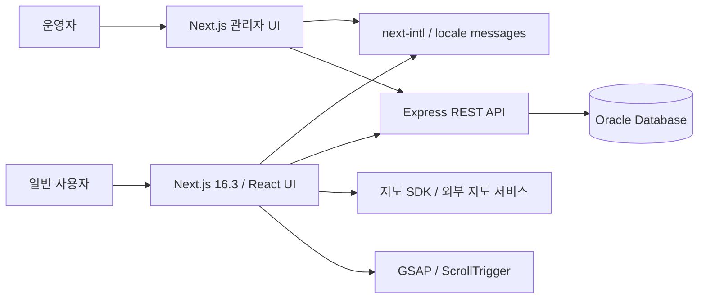

# 시스템 아키텍처 및 데이터 흐름

## 1. 시스템 구조



**주의:** 이 다이어그램은 대화·공유 코드에 근거한 **논리 아키텍처**입니다. 실제 배포 인프라, API 게이트웨이, 인증 전략, DB 접근 권한 등의 전부를 검증한 그림이 아닙니다.

## 2. 사용된 기술의 역할

| 기술 | 책임 | 경계·주의사항 |
| --- | --- | --- |
| Next.js App Router | 페이지/레이아웃/메타데이터, 서버·클라이언트 컴포넌트 경계 | 정적 export에서 `headers()` 등의 요청 의존 기능 제한 |
| React/TypeScript | 컴포넌트, 상태, 이벤트, API 타입 | 외부 SDK가 바꾼 DOM과 언마운트 충돌 가능 |
| Styled-Components | UI 스타일의 모듈화, props 기반 변형 | SSR/클라이언트 삽입 순서 및 반응형 스타일 검증 |
| next-intl | 로케일 기반 UI 번역 | 관리자 콘텐츠 번역은 별도 데이터 계층 |
| GSAP/ScrollTrigger | 타임라인/스크롤 연동 연출 | 컴포넌트 cleanup과 pin-spacer 복구 |
| Express | 인증/콘텐츠/예약 등 REST API | 프론트와 독립 배포 및 CORS·세션 설정 |
| Oracle + TypeORM/SQL | 영속 데이터·스키마/제약 | 실제 테이블, quoted identifier, CLOB, 엔티티 매핑 일치 |
| Naver/Kakao/Google 지도 | 오시는 길·위치 탐색 | 스크립트 lazy loading과 외부 SDK 정리 |

## 3. CMS 번역 요청 흐름

```text
관리자 콘텐츠 선택 (FOOTER / VLOG / SAFETY / CATEGORY ...)
  → API에서 번역 원본 조회
  → 저장 시 콘텐츠 유형 및 언어 검사
  → Oracle CMS 번역 관련 테이블/제약
  → 사용자 페이지에서 locale별 결과 요청/표시
```

실제 디버깅에서 **새 콘텐츠 유형을 화면에 추가했지만 DB 체크 제약이 이를 허용하지 않아 실패**한 사례가 있었습니다. 따라서 프론트 타입, 서버 처리, 데이터베이스 제약을 함께 변경해야 합니다.

## 4. 지도 렌더링의 성능 구조

공유된 `HospitalMap` 관련 구현 기록에서는 `IntersectionObserver`를 활용해 지도 영역이 화면에 가까워질 때 SDK 초기화를 시작했습니다(`rootMargin: "450px 0px"`). 지도 전환은 keyed `SdkMap` 전략을 사용한 기록이 있으며, 외부 링크에는 `noopener noreferrer`를 적용했습니다. 다른 시점의 코드에서는 `data-lenis-prevent`가 일반 휠 스크롤을 막을 수 있어 제거하는 수정이 논의됐습니다.

**면접 포인트:** 비용이 큰 외부 SDK를 필요 시점에 불러오는 대신, 초기화·전환·언마운트 시 DOM 정리 충돌 여부를 반드시 함께 확인해야 합니다.

## 5. 배포 구성의 분리

### 로컬 동적 실행

```text
Next.js dev/server  ↔  Express API  ↔  OracleDB
```

### 발표용 정적 출력

```text
Next.js build/export → out/ → Cafe24 FTP → HTML/CSS/JS 제공
                                    (서버 API/DB는 포함되지 않음)
```

정적 출력에서 서버 요청 헤더·동적 서버 API·세션 인증을 그대로 제공할 수 없습니다. 따라서 메인 화면/애니메이션 등은 정적으로 전달하더라도 **실제 로그인·예약·CMS 데이터 저장은 별도 API 서버와 적절한 도메인·인증·HTTPS 설정 없이는 완성된 상태가 아닙니다.**

## 6. 공개용 저장소 추천 구조

```text
project/
├── README.md
├── docs/
│   ├── 01-I18N-ENGINEERING.md
│   ├── 02-GSAP-UIUX.md
│   ├── 03-ARCHITECTURE.md
│   ├── 04-REQUIREMENTS.md
│   ├── 05-TROUBLESHOOTING.md
│   ├── 06-INTERVIEW-QA.md
│   └── 07-PUBLISH-CHECKLIST.md
├── clinic-frontend/
│   └── ...
└── clinic-backend/
    └── ...
```

실제 디렉터리명은 저장소에 맞춰 조정 가능합니다. 배포용 파생 정적 소스는 원본 코드와 섞지 않는 것이 좋습니다.
